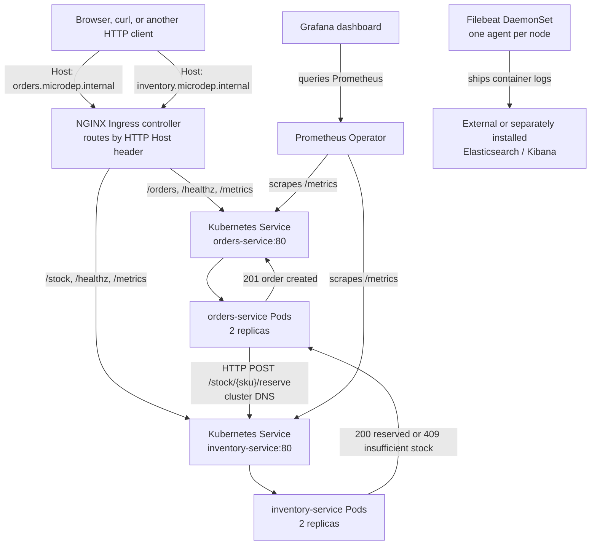
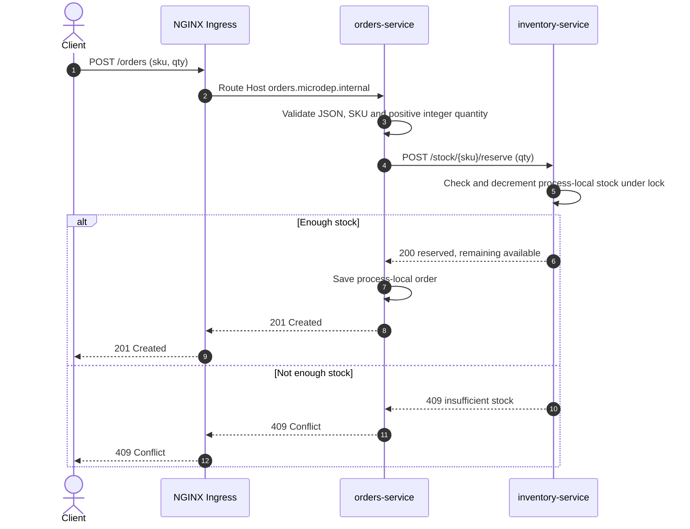

# MicroDep: Microservices CI/CD Demo

MicroDep is a learning project that demonstrates two small HTTP services,
container images, Kubernetes deployments, an ingress route, CI/CD with Jenkins,
AWS infrastructure with Terraform, and optional metrics and log collection.

This README explains the project from the beginning and gives a local WSL
workflow that does not require an AWS account.

> **Demo, not production software:** orders and stock are stored in each
> service process's memory. Kubernetes runs multiple replicas, and those
> replicas do not share that memory. Data can differ between requests and is
> lost when a container restarts. The demo has no database, durable order
> processing, authentication, or idempotency guarantees. Do not use it for
> real orders or production workloads.

## What you will run

There are two Flask APIs:

- **orders-service** accepts orders and calls the inventory API to reserve the
  requested quantity.
- **inventory-service** reports seeded stock and handles reservations.

You can run them locally as Docker containers with Compose, or load the
container images into a local Kubernetes cluster created with `kind`. In the
Kubernetes version, Services provide stable in-cluster addresses and an
NGINX Ingress controller routes HTTP requests to the right service.

## Architecture

### Runtime request and telemetry flow



The client can access the services through Ingress or directly through
`kubectl port-forward`. Within the cluster, Kubernetes Services provide stable
DNS names and distribute requests across ready Pods. The inventory call is
service-to-service HTTP traffic; the Ingress is for client entry, not for that
internal call.

The Prometheus ServiceMonitor and Filebeat configuration are optional
integrations. Elasticsearch/Kibana and the Prometheus Operator stack must be
installed separately; applying these project manifests alone does not install
those platforms.

### End-to-end delivery and infrastructure flow

```mermaid
flowchart LR
    developer["Developer changes code"]
    tests["Run pytest suites"]
    local["Optional local check<br/>Docker Compose or kind"]
    git["Push commit to GitHub"]
    trigger["Jenkins trigger<br/>webhook, SCM polling or manual"]
    jenkins["Jenkins Pipeline"]
    validate["Validate GHCR image prefix"]
    build["Build service images<br/>tag with commit SHA"]
    ghcr["GitHub Container Registry"]
    render["Replace manifest image/version"]
    cluster["Kubernetes cluster<br/>kind locally or EKS"]
    rollout["Wait for Deployments"]
    smoke["Smoke check /healthz<br/>and /metrics"]
    rollback["On failure, roll back<br/>changed existing Deployments"]
    terraform["Terraform"]
    vpc["AWS VPC, subnets,<br/>NAT and EKS nodes"]
    metrics["Optional Prometheus<br/>and Grafana"]
    logs["Optional Filebeat<br/>to Elasticsearch"]

    developer --> tests --> local
    developer --> git --> trigger --> jenkins
    jenkins --> validate --> build --> ghcr
    ghcr --> render --> cluster --> rollout --> smoke
    smoke -. failure .-> rollback
    terraform --> vpc --> cluster
    cluster -. optional monitoring .-> metrics
    cluster -. optional logging .-> logs
```



The local path ends at a kind cluster and does not require Jenkins, GHCR,
Terraform or AWS. The cloud path is optional: Terraform creates the AWS
infrastructure; Jenkins publishes images and deploys them to the configured
cluster. A Jenkins job needs its credentials, tools, AWS permissions and
network access configured separately.

### Order request sequence



### What happens when an order is placed

1. A client sends `POST /orders` to orders-service with an SKU and quantity.
2. orders-service validates the JSON, SKU and positive integer quantity.
3. It sends `POST /stock/{sku}/reserve` to inventory-service over HTTP.
4. inventory-service checks and updates its local in-memory stock while holding
   a thread lock. It returns `409` if there is not enough stock.
5. If the reservation succeeds, orders-service records the order in its own
   in-memory dictionary and returns `201 Created`.

The lock prevents two threads in one inventory process from overselling that
process's stock. It does **not** coordinate separate pods or survive restarts.

## Repository guide

| Path | Purpose |
| --- | --- |
| `services/orders-service/app.py` | Orders API, request validation, inventory HTTP client, health endpoints and Prometheus metrics. |
| `services/orders-service/requirements.txt` | Python dependencies for orders-service. |
| `services/orders-service/Dockerfile` | Builds the non-root Python/Gunicorn orders image. |
| `services/orders-service/.dockerignore` | Keeps tests, caches and local environments out of the orders image build context. |
| `services/orders-service/tests/` | Orders API tests. |
| `services/inventory-service/app.py` | Stock lookup and reservation API, health endpoints and Prometheus metrics. |
| `services/inventory-service/requirements.txt` | Python dependencies for inventory-service. |
| `services/inventory-service/Dockerfile` | Builds the non-root Python/Gunicorn inventory image. |
| `services/inventory-service/.dockerignore` | Keeps tests, caches and local environments out of the inventory image build context. |
| `services/inventory-service/tests/` | Inventory API tests, including concurrent reservation coverage. |
| `requirements.txt` | Root-level development/test dependencies for repository checks; includes both services' dependencies and pytest. |
| `docker-compose.yml` | Local two-container development setup. |
| `scripts/local-test.sh` | Bash smoke test for WSL/Linux/macOS with Docker Compose v2. |
| `scripts/local-test.ps1` | PowerShell smoke test for Windows with Docker Compose v2. |
| `k8s/namespace-and-ingress.yaml` | `microdep` namespace and host-based Ingress resource. |
| `k8s/orders-service.yaml` | Orders Deployment, Service and CPU-based HPA. |
| `k8s/inventory-service.yaml` | Inventory Deployment and Service. |
| `Jenkinsfile` | Jenkins test, image publication, Kubernetes rollout and smoke-test pipeline. |
| `terraform/main.tf` | AWS VPC, EKS cluster, networking, node group and core EKS add-ons. |
| `terraform/variables.tf` | Region, cluster, node sizing and restricted cluster API CIDR settings. |
| `terraform/outputs.tf` | EKS connection details and kubeconfig command. |
| `monitoring/servicemonitor.yaml` | Prometheus Operator configuration for scraping service metrics. |
| `monitoring/grafana-dashboard.json` | Example Grafana dashboard; adapt queries if metric labels differ in your setup. |
| `logging/filebeat-daemonset.yaml` | Filebeat, configuration and read-only Kubernetes metadata RBAC. |
| `.gitignore` | Excludes local Python environments, secrets files, downloaded tools, test output and Terraform state. |
| `.gitattributes` | Normalizes text files and keeps Bash scripts on LF line endings across Windows and Linux. |
| `LICENSE` | MIT License; update its copyright holder if you want your name or organization shown. |

## Prerequisites

### For the local WSL workflow

- Ubuntu on WSL 2.
- Docker Engine and Docker Compose v2 available from WSL.
- `curl`.
- Python 3 and `python3-venv` only if running tests locally.
- `kubectl` and `kind` only for the Kubernetes steps.

Check the important commands:

```bash
docker version
docker compose version
curl --version
kubectl version --client
kind version
```

The local Docker smoke test needs Docker and Compose. A local Kubernetes
deployment additionally needs a working Kubernetes context created by `kind`.

### Set up Docker in Ubuntu on WSL

Install Docker Engine and its Compose plugin if the `docker compose version`
check fails. Ubuntu 26.04 and current Ubuntu LTS releases are supported by
Docker's [official Ubuntu installation instructions](https://docs.docker.com/engine/install/ubuntu/).

First check whether WSL is running systemd:

```bash
ps -p 1 -o comm=
```

If the result is not `systemd`, edit `/etc/wsl.conf` (for example with
`sudo nano /etc/wsl.conf`) and ensure it contains:

```ini
[boot]
systemd=true
```

Do not add a duplicate `[boot]` section if one is already present. Save the
file, close the WSL shells, and run `wsl --shutdown` from Windows PowerShell.
Reopen Ubuntu before continuing.

Install Docker from its signed package repository:

```bash
sudo apt update
sudo apt install -y ca-certificates curl
sudo install -m 0755 -d /etc/apt/keyrings
sudo curl -fsSL https://download.docker.com/linux/ubuntu/gpg \
  -o /etc/apt/keyrings/docker.asc
sudo chmod a+r /etc/apt/keyrings/docker.asc

sudo tee /etc/apt/sources.list.d/docker.sources >/dev/null <<EOF
Types: deb
URIs: https://download.docker.com/linux/ubuntu
Suites: $(. /etc/os-release && echo "\${UBUNTU_CODENAME:-$VERSION_CODENAME}")
Components: stable
Architectures: $(dpkg --print-architecture)
Signed-By: /etc/apt/keyrings/docker.asc
EOF

sudo apt update
sudo apt install -y docker-ce docker-ce-cli containerd.io \
  docker-buildx-plugin docker-compose-plugin
sudo systemctl enable --now docker
sudo docker run hello-world
docker compose version
```

If you do not have systemd enabled, complete the WSL systemd step above before
running `systemctl`. To run Docker without `sudo`, add your WSL user to the
`docker` group and then close and reopen Ubuntu:

```bash
sudo usermod -aG docker "$USER"
```

Membership in the `docker` group grants root-equivalent privileges. Only add a
trusted user to this group.

### For optional AWS deployment

- An AWS account, AWS CLI v2 and configured AWS credentials.
- Terraform 1.5 or later, `kubectl` and Helm.
- Permission to create EKS, EC2 worker nodes, VPC resources and a NAT Gateway.
- A public GHCR package for each service, or configured Kubernetes pull
  credentials for private images.
- A Linux Jenkins agent with Docker, Python 3, `kubectl`, `curl`, `sed`, AWS
  authentication and network access to the EKS API.

**AWS resources cost money.** In particular, EKS, EC2 nodes and the NAT Gateway
can continue to incur charges until destroyed. Review Terraform's plan and
remove the resources when no longer needed.

## Part 1: Run locally with Docker Compose

From the WSL terminal, go to the repository root:

```bash
cd "/mnt/c/Users/Acer/Downloads/New Profile/microdep-cicd-pipeline"
```

Build the images, start both APIs, check the order-to-inventory request and
clean up the containers:

```bash
bash ./scripts/local-test.sh
```

The expected final line is:

```text
Local smoke test passed.
```

The script checks service health, orders two seeded `sku-100` items and
confirms inventory falls from 50 to 48. It also prints Compose logs if the
smoke test fails. Run the script with `bash`, **not** `sh`; it uses Bash
features.

### Keep the Compose services running

```bash
docker compose up --build -d
docker compose ps
```

Then try the APIs:

```bash
curl -i http://localhost:8080/healthz
curl -i http://localhost:8081/stock/sku-100

curl -i -X POST http://localhost:8080/orders \
  -H 'Content-Type: application/json' \
  -d '{"sku":"sku-100","qty":2}'

curl -i http://localhost:8080/metrics
curl -i http://localhost:8081/metrics
```

Orders listens on host port `8080`; inventory listens on `8081`. The containers
communicate on the Compose network using the DNS name `inventory-service` and
port `8080`. Each newly started inventory container seeds its own in-memory
stock; start a fresh Compose stack to reset it to the sample values.

Stop the services and remove the Compose network:

```bash
docker compose down
```

## Part 2: Run unit tests

From the project root in WSL:

```bash
python3 -m venv .venv-wsl
source .venv-wsl/bin/activate
python -m pip install -r requirements.txt

(cd services/orders-service && python -m pytest -q)
(cd services/inventory-service && python -m pytest -q)
```

At the time this guide was written, both service test suites contain five
tests. To leave the virtual environment, run `deactivate`.

## Part 3: Deploy to local Kubernetes with kind

This is optional: Compose already gives you a local two-service app. `kind`
creates a Kubernetes cluster inside Docker, so this step exercises Deployments,
Services, probes, the HPA object and Ingress without creating AWS infrastructure.

### 3.1 Create and check the cluster

Install `kubectl` and `kind` if they are not already available. Follow their
official instructions:

- [Install kubectl on Linux](https://kubernetes.io/docs/tasks/tools/install-kubectl-linux/)
- [kind quick start and installation](https://kind.sigs.k8s.io/docs/user/quick-start/)

Use a `kubectl` version within one minor release of the cluster's Kubernetes
server version. Check both client and server versions with `kubectl version`.

Create a cluster named `microdep`:

```bash
kind create cluster --name microdep
kubectl config use-context kind-microdep
kubectl wait --for=condition=Ready node --all --timeout=180s
kubectl get nodes
```

The node should eventually show `Ready`. A new kind node can briefly show
`NotReady` during startup. If it does not become ready:

```bash
kubectl get pods -A -o wide
kubectl get events -A --sort-by=.lastTimestamp | tail -40
kubectl describe node
kind export logs /tmp/microdep-kind-logs
```

### 3.2 Build and load the service images

Build the Compose images, then load those exact local image tags into kind:

```bash
docker compose build
kind load docker-image microdep-orders-service:local \
  microdep-inventory-service:local --name microdep
```

`kind load` transfers images from Docker to the kind cluster's node. This lets
Kubernetes run them without pushing to a public image registry. The Kubernetes
manifests use `imagePullPolicy: IfNotPresent`.

### 3.3 Apply namespace, Deployments and Services

Run the following from the repository root. The `sed` commands substitute the
placeholder registry images in the checked-in manifests with images loaded
into kind:

```bash
kubectl apply -f k8s/namespace-and-ingress.yaml

sed 's|ghcr.io/OWNER/REPO/inventory-service:REPLACE_ME|microdep-inventory-service:local|' \
  k8s/inventory-service.yaml | kubectl apply -f -

sed 's|ghcr.io/OWNER/REPO/orders-service:REPLACE_ME|microdep-orders-service:local|' \
  k8s/orders-service.yaml | kubectl apply -f -

kubectl rollout status deployment/inventory-service -n microdep --timeout=180s
kubectl rollout status deployment/orders-service -n microdep --timeout=180s
kubectl get pods,services -n microdep
```

Wait for both Deployments to finish rolling out. The health probes check
`/healthz` and `/readyz`. orders-service reaches inventory using the in-cluster
DNS name `inventory-service.microdep.svc.cluster.local:80`.

The orders Deployment specifies two replicas, a HorizontalPodAutoscaler with a
target of 70% average CPU and a range of 2-6 replicas. The HPA needs a Metrics
Server in the cluster to calculate CPU usage; an HPA object may exist without
working scaling metrics until Metrics Server is installed.

### 3.4 Test Kubernetes services with port-forward

Port-forward commands stay running in the terminal. Open **two WSL terminals**.

Terminal 1:

```bash
kubectl -n microdep port-forward svc/orders-service 18080:80
```

Terminal 2:

```bash
kubectl -n microdep port-forward svc/inventory-service 18081:80
```

In a third terminal:

```bash
curl -i http://localhost:18080/healthz
curl -i http://localhost:18081/healthz

curl -i -X POST http://localhost:18080/orders \
  -H 'Content-Type: application/json' \
  -d '{"sku":"sku-100","qty":2}'
```

The expected health status is `200`; an accepted order returns `201 Created`.
Stop each port-forward with `Ctrl+C`.

If kubectl reports `TYPE/NAME and list of ports are required`, include both a
resource and the port mapping as in `svc/orders-service 18080:80`. If a Service
cannot be found, check that you are using the right context and namespace:

```bash
kubectl config current-context
kubectl get pods,services -n microdep
```

### 3.5 Optional Ingress for host-based local URLs

The checked-in Ingress requires an NGINX Ingress controller. Install the
controller, wait for it, and forward its HTTP port:

```bash
kubectl apply -f https://raw.githubusercontent.com/kubernetes/ingress-nginx/controller-v1.15.1/deploy/static/provider/cloud/deploy.yaml

kubectl wait --namespace ingress-nginx \
  --for=condition=Ready pod \
  --selector=app.kubernetes.io/component=controller \
  --timeout=180s
```

In a separate terminal, keep this command running:

```bash
kubectl -n ingress-nginx port-forward \
  svc/ingress-nginx-controller 18082:80
```

The `Host` header selects the corresponding rule:

```bash
curl -i -H 'Host: orders.microdep.internal' \
  http://localhost:18082/healthz

curl -i -H 'Host: inventory.microdep.internal' \
  http://localhost:18082/healthz

curl -i -X POST http://localhost:18082/orders \
  -H 'Host: orders.microdep.internal' \
  -H 'Content-Type: application/json' \
  -d '{"sku":"sku-100","qty":2}'
```

Both health checks should return `200`; a successful order returns `201`.
This is an HTTP-only local demo, not a public DNS or TLS setup. Stop the
port-forward with `Ctrl+C`.

### 3.6 Remove the local cluster

This deletes the kind cluster and its Kubernetes resources:

```bash
kind delete cluster --name microdep
```

Docker images and your project files are not deleted by that command. Use
`docker compose down` to stop a separately running Compose stack.

## API reference

| Service | Method and path | Purpose | Typical result |
| --- | --- | --- | --- |
| Orders | `GET /healthz` | Liveness check. | `200 {"status":"ok"}` |
| Orders | `GET /readyz` | Readiness check. | `200 {"status":"ready"}` |
| Orders | `GET /metrics` | Prometheus metrics. | `200` with Prometheus text |
| Orders | `GET /version` | Service name and `APP_VERSION`. | `200` JSON |
| Orders | `POST /orders` | Validate and reserve inventory, then create an in-memory order. | `201`, `400`, `409` or `503` |
| Orders | `GET /orders/{order_id}` | Look up an in-memory order. | `200` or `404` |
| Inventory | `GET /healthz` | Liveness check. | `200 {"status":"ok"}` |
| Inventory | `GET /readyz` | Readiness check. | `200 {"status":"ready"}` |
| Inventory | `GET /metrics` | Prometheus metrics. | `200` with Prometheus text |
| Inventory | `GET /version` | Service name and `APP_VERSION`. | `200` JSON |
| Inventory | `GET /stock/{sku}` | Read stock from the selected process. | `200` JSON |
| Inventory | `POST /stock/{sku}/reserve` | Atomically reserve a positive quantity within the selected process. | `200`, `400` or `409` |
| Inventory | `POST /stock/{sku}/decrement` | Demo endpoint that decrements stock by one. | `200` or `409` |

Example order body:

```json
{
  "sku": "sku-100",
  "qty": 2
}
```

Seeded inventory for each inventory-service process: `sku-100` has 50,
`sku-200` has 12, and `sku-300` has 0.

### Configuration

| Variable | Used by | Default | Meaning |
| --- | --- | --- | --- |
| `INVENTORY_URL` | orders-service | `http://inventory-service:80` | Base URL of inventory-service. Compose overrides this to `http://inventory-service:8080`; Kubernetes sets its cluster Service DNS name. |
| `APP_VERSION` | both services | `dev` | Value returned by `/version`. Jenkins sets the version from the commit SHA in rendered manifests. |

## Publish this project to GitHub

These steps publish the current project folder as a new GitHub repository. You
will need a GitHub account and Git installed in WSL. Choose **Public** or
**Private** when creating the repository; public repositories can be viewed and
cloned by anyone.

### 1. Check and prepare the working folder

From WSL, change to the project folder. Use your own Windows username if the
project is under `/mnt/c/Users/`:

```bash
cd "/mnt/c/Users/YOUR_WINDOWS_USERNAME/Downloads/New Profile/microdep-cicd-pipeline"
```

Install Git if needed and check whether this folder is already a Git repository:

```bash
git --version
git status
```

If Git is not installed:

```bash
sudo apt update
sudo apt install -y git
```

If `git status` says this directory is not a repository, initialize it. If it
already shows a branch and working-tree status, keep that repository and do not
initialize it again:

```bash
git init -b main
```

Set the name and email that should appear on your commits (use the email
associated with GitHub if you want commits linked to your GitHub profile):

```bash
git config user.name "Your Name"
git config user.email "you@example.com"
```

### 2. Create an empty GitHub repository

On GitHub, create a repository, choose its visibility, and copy its HTTPS URL,
for example `https://github.com/YOUR_GITHUB_USERNAME/microdep-cicd-pipeline.git`.
Because this folder already contains a README, license and `.gitignore`, leave
the GitHub options to initialize those files **unchecked**. Otherwise GitHub
will create a separate first commit that must be reconciled before pushing.

Suggested repository description: `A learning project for Flask microservices, Docker, Kubernetes, Jenkins CI/CD, and Terraform on AWS.`
Suggested topics: `microservices`, `flask`, `docker`, `kubernetes`, `jenkins`,
`terraform`, `aws`, `devops`.

### 3. Review what will be published

Add the project files, then inspect the staged changes before committing:

```bash
git add .
git status --short
git diff --cached --check
git diff --cached --stat
```

Confirm that the staged files include `README.md` and `LICENSE`, and do **not**
include `.venv*`, `__pycache__`, `.env` secrets, downloaded `kubectl`/`kind`
binaries, Terraform state, Terraform variable files or credentials. Do not use
`git add -f` on generated environments or secret files. If an unexpected file
is staged, remove it from staging with `git restore --staged <path>` and review
`.gitignore` before proceeding.

### 4. Commit and push

Replace the example URL with the HTTPS URL copied from your GitHub repository:

```bash
git branch -M main
git remote add origin https://github.com/YOUR_GITHUB_USERNAME/microdep-cicd-pipeline.git
git commit -m "Prepare MicroDep microservices demo"
git push -u origin main
```

If `origin` already exists, inspect it with `git remote -v` and use
`git remote set-url origin <your-repository-HTTPS-URL>` only if it points to the
wrong repository. When Git asks for credentials over HTTPS, authenticate using
GitHub's browser/device flow or a credential manager; GitHub account passwords
are not accepted for Git pushes. Never paste a personal access token into this
README, a source file, or a Git remote URL.

Refresh the repository page on GitHub. GitHub renders the Mermaid architecture
diagrams in this README and detects the `LICENSE` file automatically. Before
publishing publicly, ensure the MIT license copyright line
`Copyright (c) 2026 MicroDep contributors` is the attribution you intend to
use. If you want your own name or organization on it, edit `LICENSE` before
the commit and push.

For automated Jenkins runs after a GitHub push, configure a GitHub webhook in
the repository and a matching webhook trigger in Jenkins, or enable a Jenkins
SCM polling/build trigger. The `Jenkinsfile` defines pipeline stages, but does
not configure a GitHub webhook or automatically create the Jenkins job.

## Optional project extensions

These are separate from the verified local workflow. The local kind cluster
does not configure AWS, Jenkins, Prometheus, Grafana or Elasticsearch by itself.

### Jenkins CI/CD with GHCR

The [Jenkinsfile](./Jenkinsfile) describes this pipeline:

1. Check out the repository.
2. Validate `IMAGE_REGISTRY`, in the form `ghcr.io/<owner>/<package>`.
3. Install Python requirements and pytest, then run both service test suites.
   A test failure stops the pipeline.
4. Build and push each service image tagged with the full Jenkins Git commit
   SHA. Jenkins logs into GHCR with its credentials and logs out afterwards.
5. Apply the namespace/Ingress manifest and apply each service manifest after
   replacing its placeholder image and `APP_VERSION`.
6. Wait for both Kubernetes deployments to roll out.
7. Use Kubernetes port-forwarding to check both `/healthz` and `/metrics`.
8. On a pipeline failure, run `kubectl rollout undo` for changed deployments
   that existed before the run.

To use it, create a Jenkins Pipeline job and configure:

- `kubeconfig-microdep`: Jenkins **Secret file** credential containing the
  target cluster kubeconfig.
- `registry-credentials`: Jenkins **Username with password** credential for
  GHCR. Use a GitHub token with permission to publish packages.
- A Linux Jenkins agent with Docker, Python 3, `kubectl`, `curl` and `sed`.
- AWS CLI credentials and EKS permissions if the target is EKS. The agent must
  be allowed by the cluster API CIDR and have network access to its endpoint.
- The build parameter `IMAGE_REGISTRY`, for example
  `ghcr.io/my-user/microdep`.

For private GHCR packages, Kubernetes nodes need a matching `imagePullSecret`
and the deployment pods must reference it. The current manifests do not define
that secret. Jenkins also assumes the ingress controller is already installed;
it does not install the controller, Helm releases or monitoring stack.

### AWS EKS using Terraform

Terraform defaults are in `terraform/variables.tf`: region `us-east-1`, EKS
version `1.37`, cluster name `microdep-cluster`, two AZs and two desired
`t3.medium` nodes. It creates a VPC with public/private subnets, one NAT
Gateway, EKS, a managed node group and core networking/DNS add-ons. The EKS API
is public but restricted by the required `cluster_admin_cidr` variable.

From the WSL terminal, first configure AWS CLI credentials. Then:

```bash
cd "/mnt/c/Users/Acer/Downloads/New Profile/microdep-cicd-pipeline/terraform"
terraform init
ADMIN_IP="$(curl -fsS https://checkip.amazonaws.com | tr -d '\r\n')"
terraform plan -var "cluster_admin_cidr=${ADMIN_IP}/32"
```

Review the plan and AWS charges. Only if you intend to create billable AWS
resources, apply it:

```bash
terraform apply -var "cluster_admin_cidr=${ADMIN_IP}/32"
```

Update kubeconfig and check nodes:

```bash
aws eks update-kubeconfig --region us-east-1 --name microdep-cluster
kubectl get nodes
```

If using Jenkins from a different IP address, allow that agent IP as well in
`cluster_admin_cidr`. If changing AWS regions, provide at least two AZ names
from that region. To clean up AWS resources created by this Terraform state:

```bash
terraform destroy -var "cluster_admin_cidr=${ADMIN_IP}/32"
```

Check AWS for separately installed Helm releases, registry images or other
resources not managed by this Terraform configuration.

### Prometheus and Grafana

`monitoring/servicemonitor.yaml` selects services labeled
`app=orders-service` or `app=inventory-service`, then scrapes their named
`http` ports at `/metrics`. Install a Prometheus Operator stack first:

```bash
helm repo add prometheus-community https://prometheus-community.github.io/helm-charts
helm repo update
helm upgrade --install monitoring prometheus-community/kube-prometheus-stack \
  --namespace monitoring --create-namespace
kubectl apply -f ../monitoring/servicemonitor.yaml
```

Run this from the repository root:

```bash
kubectl apply -f monitoring/servicemonitor.yaml
```

The sample dashboard is `monitoring/grafana-dashboard.json`. Its example
PromQL selectors may need adjustment to match the labels exposed by the
Prometheus exporter and scrape configuration in your installation.

The Kubernetes HPA also needs Metrics Server. If it is not present in the
cluster, install it separately:

```bash
helm repo add metrics-server https://kubernetes-sigs.github.io/metrics-server/
helm repo update
helm upgrade --install metrics-server metrics-server/metrics-server \
  --namespace kube-system
```

### Filebeat and Elasticsearch

`logging/filebeat-daemonset.yaml` defines a Filebeat DaemonSet, ConfigMap,
ServiceAccount and read-only Kubernetes metadata permissions. It expects
Elasticsearch at `elasticsearch.logging.svc.cluster.local:9200`, with optional
Kibana at `kibana.logging.svc.cluster.local:5601`, plus standard Kubernetes
`/var/log/containers` logs. It does **not** install Elasticsearch or Kibana.
Configure authentication and TLS before using a secured or external logging
service.

Once Elasticsearch is reachable and the `microdep` namespace exists:

```bash
kubectl apply -f logging/filebeat-daemonset.yaml
kubectl get pods -n microdep -l app=filebeat
```

## Troubleshooting

| Symptom | Check / action |
| --- | --- |
| `docker compose version` fails | Confirm Docker Engine and the Compose plugin are installed and the daemon is running: `docker version`, `docker compose version`. |
| Script says Compose is unavailable | Run it with Bash: `bash ./scripts/local-test.sh`; do not invoke it using `sh`. Check Docker Engine/Compose availability from the same WSL terminal. |
| Compose smoke test times out | Run `docker compose ps` and `docker compose logs`; confirm host ports `8080` and `8081` are free. |
| kind node briefly says `NotReady` | Wait with `kubectl wait --for=condition=Ready node --all --timeout=180s`; inspect `kubectl get pods -A` if it times out. |
| Pods show `ImagePullBackOff` in kind | Rebuild Compose images and load the exact tags: `docker compose build` then `kind load docker-image microdep-orders-service:local microdep-inventory-service:local --name microdep`. Check that the applied manifests reference those tags. |
| Pod is not ready or keeps restarting | Run `kubectl get pods -n microdep`, `kubectl describe pod <pod-name> -n microdep` and `kubectl logs <pod-name> -n microdep`. |
| `port-forward` says TYPE/NAME and ports required | Give a resource and a local:remote port mapping, e.g. `kubectl -n microdep port-forward svc/orders-service 18080:80`. |
| Ingress returns 404 | Confirm the ingress-nginx controller is ready, `microdep-ingress` exists, and the request has the correct `Host` header. |
| HPA has unknown CPU metrics | Install/check Metrics Server and inspect `kubectl top pods -n microdep`. |
| An order succeeds but a stock/order lookup looks inconsistent | This is a known limitation: each replica has separate in-memory state. The demo needs a shared database to make state consistent across pods. |

## Completion checklist

For the **local demo**, the core workflow is complete when:

- `bash ./scripts/local-test.sh` passes.
- Both service test suites pass.
- The kind cluster has ready nodes, and both deployments roll out.
- Health checks return `200`, and creating an order returns `201`.
- If using Ingress, both host-based health routes return `200`.

Prometheus/Grafana, Filebeat/Elasticsearch, Jenkins and AWS EKS are optional
extensions; they are not prerequisites for completing the local demo.

## License

This project is licensed under the MIT License; see [LICENSE](./LICENSE).
Before publishing, replace `MicroDep contributors` in the copyright notice
with the name of the copyright holder if that is the attribution you intend.
